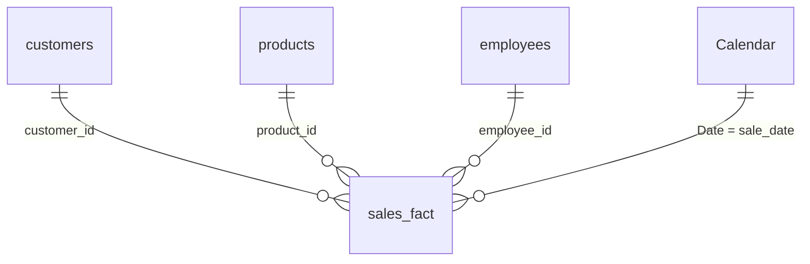

# Retail Sales Analytics Dashboard (Power BI)

An interactive, multi-page Power BI report that turns raw retail sales CSVs into a clean data model and answers everyday business questions: *Where does revenue come from? Which products and customers drive it? How is it trending month over month?*


> **Note on the data:** this is a small **sample dataset** (26 transactions, Jan–Feb 2026) built to practice and demonstrate data modelling, DAX and dashboard design. Figures illustrate the techniques, not real company performance.

---

## 1. Project Overview

| | |
|---|---|
| **Domain** | Retail (clothing, footwear, accessories) |
| **Scope** | 26 sales, 7 customers, 8 products, 3 employees, 3 cities (Chennai, Bangalore, Coimbatore) |
| **Period** | 5 Jan 2026 – 16 Feb 2026 |
| **Tools** | Power BI Desktop, Power Query (M), DAX |
| **Report size** | 3 pages (overview, product/customer analysis, drillthrough detail) |

## 2. Business Questions Answered

1. What is total revenue, and how does it split by **payment mode, city, category and month**?
2. Which **products** and **customers** contribute the most revenue, and how do they rank?
3. How does each customer perform **against the average customer**?
4. How is revenue progressing **month-to-date, quarter-to-date and year-to-date**?
5. Can a user quickly **drill from a city into its customer-level detail**?

## 3. Data Model

Star schema: one fact table (`sales_fact`) surrounded by dimension tables, plus a date table for time intelligence.



| Table | Role | Key columns |
|---|---|---|
| `sales_fact` | Fact: one row per sale | sale_id, sale_date, quantity, payment_mode, total_amount |
| `products` | Dimension | product_name, category, base_price, Price Tier |
| `customers` | Dimension | customer_name, city |
| `employees` | Dimension | employee_name |
| `Calendar` | Date table (`CALENDARAUTO()`) | Date, Year, Month Name |

## 4. Data Preparation (Power Query)

| Problem in the raw data | What I did |
|---|---|
| `payment_mode` had inconsistent casing (`upi` vs `UPI`) | Standardised the values so UPI is not split into two categories |
| Blank values in `quantity` | Replaced blanks with `1` and converted the column to a whole number (assumption: a sale record implies at least one unit) |
| Product details lived in a separate file | Merged `products` into `sales_fact` and expanded the product name and category |
| Category text was inconsistent | Converted `category` to upper case |
| Customer names stored as one text field | Trimmed spaces and split into first and last name |
| No flag for large orders | Added a conditional column marking quantity = 3 as a bulk order |
| Revenue was not in the source | Created `total_amount = quantity × base_price` using `RELATED()` |

Calculated columns added in the model: `Order Size` (Bulk / Normal), `Price Tier` (Cheap / Medium / Expensive from `base_price`), `Product Category`, `Times Sold`.

## 5. Dashboard Walkthrough

### Page 1: Sales Overview


**What it shows:** headline KPIs, revenue split by payment mode (donut), revenue by month, city and payment mode (clustered column), a product table with price tier and share of total, a customer ranking table and a month-level matrix with MTD / QTD / last-year / YTD.

**Interactive features**
- **Category slicer** to filter the whole page (the screenshot has Footwear and Accessories selected).
- **Field-parameter slicer** that lets the user switch the breakdown dimension (city, payment mode or quantity).
- **Bookmark buttons** ("UPI only" / "All Payments") to toggle a view in one click.
- **Dynamic title** on the matrix that updates to the selected city ("Revenue for All Cities").
- **Drillthrough by city** to the customer detail page, with a back button.

### Page 2: Product & Customer Analysis


**What it shows:** product ranking by revenue, each customer's revenue compared with the average customer, and a payment-mode slicer.

**Techniques demonstrated**
- `Product Rank`: `RANKX` combined with `ISINSCOPE` so ranks appear only at product level.
- `Revenue vs Avg`: customer revenue minus the average customer revenue (`AVERAGEX` over `ALLSELECTED`), so positive/negative values show who is above or below average.
- `Crossfiltered Products`: `CROSSFILTER(... Both)` to count products that match the current selection.
- `Magic Revenue`: variable + `SELECTEDVALUE` pattern that returns revenue for the single selected payment mode (blank when none or several are selected).

### Page 3: Customer Detail (Drillthrough)


**What it shows:** reached by right-click drillthrough from a city on Page 1. A **"Select Metric" field parameter** lets the viewer switch the chart between Total Revenue, Revenue MTD and Revenue YTD, next to a payment-mode breakdown and a customer table.

## 6. Problems Solved

| # | Problem | Approach | Technique |
|---|---|---|---|
| 1 | Messy source data would give wrong totals | Cleaned text, filled blanks, fixed types in Power Query | Power Query (M) |
| 2 | Revenue was not stored in the data | Derived it from quantity and product price | Calculated column, `RELATED` |
| 3 | Data spread across 4 files | Built a star schema with one-to-many relationships | Data modelling |
| 4 | "Is this a big share of the total?" depends on the filters | Share-of-total that respects the user's selection | `ALLSELECTED`, `DIVIDE` |
| 5 | Need period-to-date trends | Time-intelligence measures on a date table | `TOTALMTD`, `TOTALQTD`, `TOTALYTD`, `SAMEPERIODLASTYEAR`, `DATEADD` |
| 6 | Who are the top products and customers? | Ranking measures that behave correctly in tables | `RANKX`, `ISINSCOPE` |
| 7 | Who is above or below average? | Customer revenue minus the average customer | `AVERAGEX`, `ALLSELECTED` |
| 8 | One page can't show every angle | Field parameters, bookmarks and drillthrough | Dashboard UX |
| 9 | Titles should reflect the selection | Dynamic title measure | `SELECTEDVALUE` |

## 7. Key Findings (full dataset, no filters)

| Question | Result |
|---|---|
| Total revenue | **55,652** across 26 sales |
| Top payment mode | **UPI**: 30,969 (about 56% of revenue), then Cash 14,889 and Card 9,794 |
| Top city | **Bangalore**: 21,989 (about 40%), then Chennai 17,278 and Coimbatore 16,385 |
| Top category | **Clothing**: 25,373 (about 46%) |
| Top product | **Sneakers**: 12,495 (about 22%), followed by Formal Shirt and Watch |
| Top customer | **Meena**: 11,492 (about 21% of revenue) |
| Month trend | February revenue (34,274) was about 60% higher than January (21,378) on the same number of sales (13 each) |

*With only 26 transactions these are descriptive observations, not statistically reliable conclusions.*

## 8. Known Limitations and Next Steps

- **Small sample and short period** (about six weeks), so no seasonality or year-over-year view is possible yet.
- `total_amount` uses list price (`base_price × quantity`), so discounts are not captured.
- Three rows have malformed `employee_id` values in the source file; they do not affect revenue, but employee-level analysis is not included until this is fixed at the source.
- Next steps: add a larger dataset, discount and cost data for **profit margin**, an employee performance page, and publish to Power BI Service.

## 9. How to Open the Project

1. Install [Power BI Desktop](https://powerbi.microsoft.com/desktop/) (free, Windows).
2. Download `powerbi/Sales_analytics_dashboard.pbix` and open it. The data is embedded, so the report loads without the CSVs.
3. To refresh from source, update the file paths in **Transform data → Power Query** to point to your local CSVs.

## 10. Repository Structure

```
retail-sales-powerbi-dashboard/
├── README.md
├── powerbi/
│   └── Sales_analytics_dashboard.pbix
├── images/
│   ├── 01-sales-overview.png
│   ├── 02-product-customer-analysis.png
│   └── 03-customer-detail-drillthrough.png
└── docs/
    └── DAX_MEASURES.md
```

The full list of DAX measures and calculated columns is in [docs/DAX_MEASURES.md](./docs/DAX_MEASURES.md).

## 11. Skills Demonstrated

Data cleaning and transformation (Power Query) · Star-schema data modelling · DAX (time intelligence, ranking, filter context, variables) · Interactive dashboard design (slicers, bookmarks, drillthrough, field parameters) · Data storytelling

## 12. Author

**[Your Name]** · [LinkedIn](https://www.linkedin.com/in/your-profile) · [Email](mailto:you@example.com)
